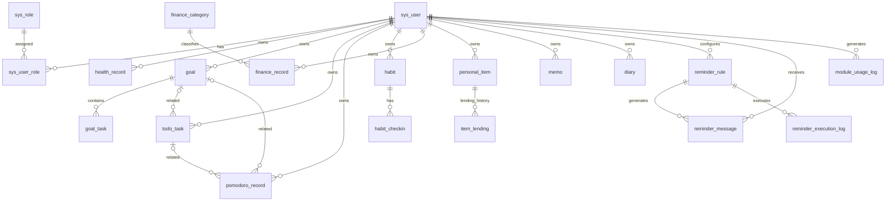

# LifeOS 数据库 ER 关系设计

## 1. 设计约定
- 数据库：MySQL 8.0，InnoDB，utf8mb4。
- 主键：BIGINT UNSIGNED 自增。
- 时间：DATETIME；由应用层统一时区策略。
- 金额：DECIMAL(12,2)；不使用浮点数。
- 用户业务表带 `user_id`，所有读写必须进行用户归属校验。
- `deleted` 为逻辑删除标记（0=正常，1=删除）。
- 关系在 SQL 中主要通过逻辑外键表达，首版不强制大量物理 FK，降低软删除与模块解耦成本。

## 2. 实体清单

| 领域 | 表 | 用途 |
|---|---|---|
| 账号 | sys_user | 普通用户/管理员账号 |
| 账号 | sys_role | 角色 |
| 账号 | sys_user_role | 用户角色关联 |
| 健康 | health_record | 健康指标记录 |
| 健康 | health_standard | 健康指标参考标准 |
| 目标 | goal | 个人目标 |
| 目标 | goal_task | 目标子任务 |
| 待办 | todo_task | 日程待办 |
| 专注 | pomodoro_record | 番茄钟会话 |
| 习惯 | habit | 习惯定义 |
| 习惯 | habit_checkin | 每日打卡 |
| 财务 | finance_category | 收支分类 |
| 财务 | finance_record | 收支明细 |
| 生活 | personal_item | 个人物品 |
| 生活 | item_lending | 借还记录 |
| 生活 | memo | 备忘录 |
| 生活 | diary | 日记 |
| 提醒 | reminder_rule | 提醒规则 |
| 提醒 | reminder_message | 站内提醒消息 |
| 提醒 | reminder_execution_log | 提醒执行幂等日志 |
| 统计 | module_usage_log | 模块关键操作记录 |

## 3. ER 图（Mermaid）

## 4. 关键关系与约束

1. `sys_user` 是所有个人业务数据的归属主体。
2. `goal` 1:N `goal_task`；子任务不可跨用户归属目标。
3. `todo_task` 可选关联一个 `goal`；删除目标时建议将关联置空，而不是级联删除待办。
4. `pomodoro_record` 可选关联目标或待办；记录归属仍以 user_id 为准。
5. `habit` 1:N `habit_checkin`；`(habit_id, checkin_date)` 唯一，避免重复打卡。
6. `finance_category` 可为系统分类（user_id NULL）或用户自定义分类（user_id 非 NULL）；记录需校验分类可见性和收支类型一致。
7. `personal_item` 1:N `item_lending`，允许保留多次借出/归还历史；同一物品同一时刻最多一笔未归还记录由业务层保证。
8. `reminder_rule` 1:N `reminder_message` 和 `reminder_execution_log`；执行日志通过唯一幂等键避免重复触发。
9. `module_usage_log` 只存模块、动作和业务对象标识，不存敏感正文。

## 5. 索引设计原则
- 用户维度查询：`(user_id, created_at)` 或 `(user_id, business_date)`。
- 时间序列查询：`(user_id, metric_code, record_time)`。
- 列表状态查询：`(user_id, status, due_at)`。
- 分类统计：`(user_id, record_type, record_date, category_id)`。
- 唯一业务约束：习惯打卡 `(habit_id, checkin_date)`；提醒幂等键 `idempotency_key`。
- 避免为低选择性字段单独建立大量索引。
